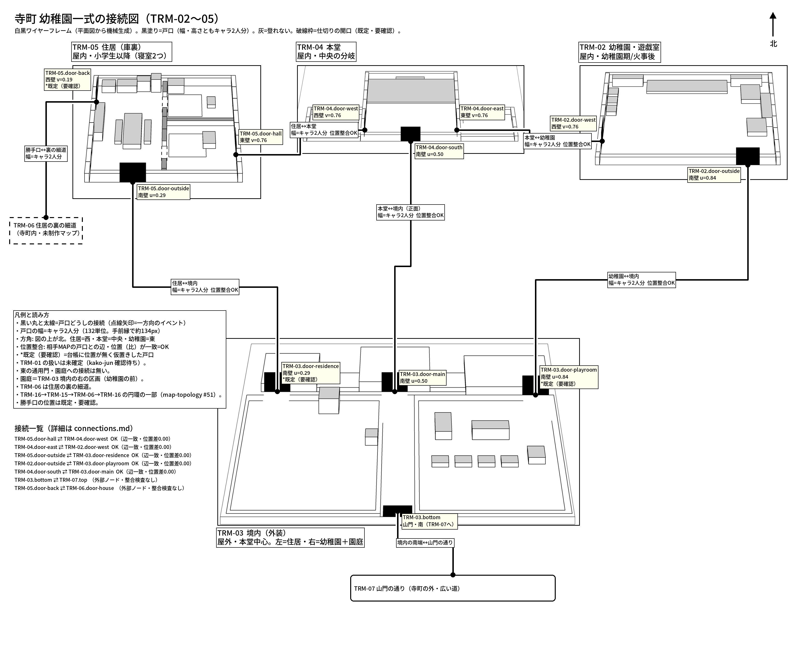

# 寺町 幼稚園一式の接続表（機械生成。`oblique_topology.py`。手で直さない）

平面図スペック（`*-plan.json`）と `connections.json` から生成。戸口の幅はすべてキャラ2人分（132平面単位。土台の手前縁で約134px。奥は遠近で縮む）。位置の比: 西・東壁の戸口は v（その部屋の奥行き方向。0=奥・1=手前）、南壁の戸口は u（幅方向。0=西・1=東）。

| 戸口A | Aの位置 | 戸口B | Bの位置 | 幅 | 位置整合 | 備考 |
|---|---|---|---|---|---|---|
| `TRM-05.door-hall` | 東壁 v=0.76（上下の中央より下寄り） | `TRM-04.door-west` | 西壁 v=0.76（上下の中央より下寄り） | 2人分（132単位） | OK（辺一致・位置差0.00） | - |
| `TRM-04.door-east` | 東壁 v=0.76（上下の中央より下寄り） | `TRM-02.door-west` | 西壁 v=0.76（上下の中央より下寄り） | 2人分（132単位） | OK（辺一致・位置差0.00） | - |
| `TRM-05.door-outside` | 南壁 u=0.29（中央より左寄り） | `TRM-03.door-residence` | 南壁 u=0.29（中央より左寄り） | 2人分（132単位） | OK（辺一致・位置差0.00） | TRM-03.door-residence は既定（要確認） |
| `TRM-02.door-outside` | 南壁 u=0.84（右寄り） | `TRM-03.door-playroom` | 南壁 u=0.84（右寄り） | 2人分（132単位） | OK（辺一致・位置差0.00） | TRM-03.door-playroom は既定（要確認） |
| `TRM-04.door-south` | 南壁 u=0.50（中央） | `TRM-03.door-main` | 南壁 u=0.50（中央） | 2人分（132単位） | OK（辺一致・位置差0.00） | - |
| `TRM-03.bottom` | 土台の南端 800 | `TRM-07.top` | （寺町の外・別MAP） | 2人分（132単位） | （外部ノード・整合検査なし） | 寺町の外への端点 |
| `TRM-05.door-back` | 西壁 v=0.19（上寄り） | `TRM-06.door-house` | （寺町内・未制作MAP） | 2人分（132単位） | （外部ノード・整合検査なし） | TRM-05.door-back は既定（要確認）・寺町内・未制作マップへの接続（点線の箱） |

## 戸口の一覧（スペック由来）

| 戸口 | MAP | 辺 | 位置 | 相手 | 備考 |
|---|---|---|---|---|---|
| `TRM-05.door-hall` | TRM-05 | east | 東壁 v=0.76（上下の中央より下寄り） | `TRM-04.door-west` | 本堂から入る。東壁・下寄り（v=0.76）。南寝室に入る形（要確認） |
| `TRM-05.door-outside` | TRM-05 | south | 南壁 u=0.29（中央より左寄り） | `TRM-03.door-residence` | 外へ。下辺の中央より左寄り（ダイニング側） |
| `TRM-05.door-back` | TRM-05 | west | 西壁 v=0.19（上寄り） | `TRM-06.door-house` | 勝手口（裏口）。台所側の西壁。家具（コンロ・流し・西の棚）を避けた位置。既定（要確認） |
| `TRM-04.door-west` | TRM-04 | west | 西壁 v=0.76（上下の中央より下寄り） | `TRM-05.door-hall` | 住居へ。西壁・下寄り（v=0.76）。先は西廊下 |
| `TRM-04.door-east` | TRM-04 | east | 東壁 v=0.76（上下の中央より下寄り） | `TRM-02.door-west` | 幼稚園へ。東壁・下寄り（v=0.76）。先は東廊下 |
| `TRM-04.door-south` | TRM-04 | south | 南壁 u=0.50（中央） | `TRM-03.door-main` | 正面扉。南壁中央（台帳 ID は door-south） |
| `TRM-02.door-west` | TRM-02 | west | 西壁 v=0.76（上下の中央より下寄り） | `TRM-04.door-east` | 本堂へ。西壁・上下の中央より下寄り（v=0.76） |
| `TRM-02.door-outside` | TRM-02 | south | 南壁 u=0.84（右寄り） | `TRM-03.door-playroom` | 外へ。下辺の右端付近。扉前は空ける |
| `TRM-03.door-main` | TRM-03 | south | 南壁 u=0.50（中央） | `TRM-04.door-south` | 本堂の正面。建物の中央 |
| `TRM-03.door-residence` | TRM-03 | south | 南壁 u=0.29（中央より左寄り） | `TRM-05.door-outside` | 住居の外への戸口。建物幅の0.29（内部の戸口と揃える）。境内側の位置は台帳TBD |
| `TRM-03.door-playroom` | TRM-03 | south | 南壁 u=0.84（右寄り） | `TRM-02.door-outside` | 幼稚園の外への戸口。建物幅の0.84（内部の戸口と揃える）。境内側の位置は台帳TBD |
| `TRM-03.bottom` | TRM-03 | south端 | 800 | `TRM-07.top` | 山門・南（TRM-07へ）  |

## 既定（要確認）とした点（各スペックの assumptions）

- TRM-05: 仕切りの開口（2か所）は設計未指定。既定: ダイニング↔北寝室（Y440）・ダイニング↔南寝室（Y841。本堂の戸口と一直線）。幅は2人分。
- TRM-05: 本堂からの戸口（東壁・v=0.76）は南寝室の側に着く。採用画像の石の敷居は東壁の中ほど（v≈0.5）にあったが、決定は『上下の中央より下寄り』。
- TRM-05: 家具の位置は採用画像 v12 から概略。
- TRM-05: 勝手口 TRM-05.door-back は寺町を行き止まりにしない円環（TRM-16→TRM-15→TRM-06→TRM-16。map-topology #51）のため追加。位置は台所側（コンロ・流し・食器棚のある側）の西壁で、コンロ（Y280〜340）と西の棚（Y492〜735）の間（中心Y420・v=0.19）。位置・壁は設計に無く既定（要確認）。相手は TRM-06.door-house（寺町内・未制作MAP）。
- TRM-04: 廊下の外端（西は x76〜100・東は x1507〜1531）は閉じた壁。住居・幼稚園へは別 MAP の戸口（本堂の西壁・東壁の戸口）から入る（README の確定: 廊下の外端案は不採用）。
- TRM-04: 廊下の奥行き Y810〜1050 と外壁の高さは採用画像 v11 から概略。
- TRM-04: 壁の飾り（芳名板・子どもの絵・灯籠・柱）は省略。
- TRM-02: 家具の位置・大きさは採用画像 v3 から概略で拾った（設計書に家具の寸法は無い）。
- TRM-02: 壁の高さ 150（前壁・側壁）・160（奥壁）。戸口の高さ134（2人分）に対する余裕。前壁を戸口高に合わせたため手前の床が約30px 隠れる。
- TRM-02: 丸テーブルの椅子・テーブルの椅子は省略。
- TRM-03: 屋根は箱の天面色で表した（形は省略。高さは画面に収めるため低め: 住居・幼稚園110・本堂150・渡り廊下70）。墓石・遊具は個別に置かず区画ラベルのみ。鐘楼・親鸞像は採用外観から概略。
- TRM-03: 参道の幅156は台帳に無く採用外観の測定。
- TRM-03: 境内側の戸口位置（住居・幼稚園）は台帳でTBD。既定を置いた（要確認）。園庭＝境内の右の区画（幼稚園の前）。東の通用門・TRM-01 への接続は無い（kako-jun 指摘、Issue #144）。
- TRM-03: 園庭の遊具（#51 既決: 滑り台1・ブランコ1・半円アーチ4=赤青黄青・動物型1）の位置と大きさは既定（要確認）。幼稚園の掃き出し窓の前（Y425〜600）と、参道・door-playroom 前の通路は空けた。歩行マスクでは遊具=blocked。
