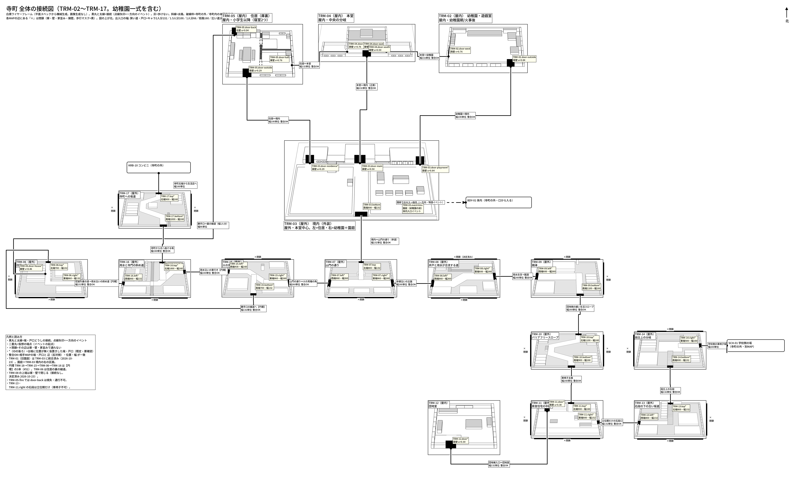
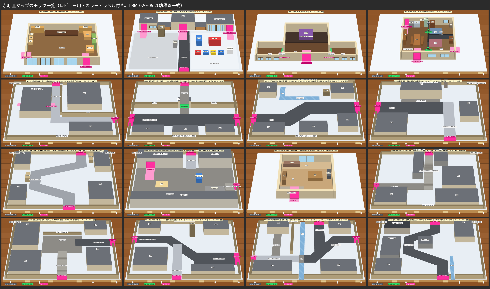

# 寺町 全マップの接続表・マップ一覧（機械生成。`oblique_town.py`。手で直さない）

平面スペック（`*-plan.json`）と `connections-teramachi.json` から生成。画像生成なし。対象=現存の寺町 TRM（TRM-02〜TRM-17。TRM-01 は 2026-10-23 に TRM-03 へ統合して廃止）。幼稚園一式（TRM-02〜05）は別担当・別 worktree で画像生成中で、ここでは読むだけ（変更しない）。

## 検査結果

- 問題: 0 件
- 台帳突合: 台帳の寺町の接続行（TRM-01 を除く）21 行 = 接続図の v2 接続 21 本。台帳に無い接続（Issue 決定）1 本: TRM-05.door-back ⇄ TRM-06.door-house
- 円環 TRM-16→TRM-15→TRM-06→TRM-16: TRM-16 → TRM-15 → TRM-06 → TRM-16 が接続図で辿れる

## マップ一覧（対象マップの洗い出し）

| MAP | 名前 | 屋内外 | 出入口（端・戸口） | 閉鎖の辺 | 設計記述（台帳） |
|---|---|---|---|---|---|
| TRM-02 | 幼稚園・遊戯室 | 屋内 | `door-west`→TRM-04.door-east `door-outside`→TRM-03.door-playroom | - | 本堂の東の屋内遊戯室（幼稚園）。扉は本堂側（西）と外（下辺右端付近）。舞台袖は画面内終端。 |
| TRM-03 | 境内（外装） | 屋外 | `door-main`→TRM-04.door-south `door-residence`→TRM-05.door-outside `door-playroom`→TRM-02.door-outside 南 `bottom`→TRM-07.top | - | 親鸞像のある浄土真宗の境内（屋外）。右の区画＝園庭（幼稚園の前）。bottom→TRM-07、door-main→TRM-04、event-kiss→BDY-01.event-mouth。 |
| TRM-04 | 本堂 | 屋内 | `door-west`→TRM-05.door-hall `door-east`→TRM-02.door-west `door-south`→TRM-03.door-main | - | 中央の屋内本堂。door-south→TRM-03、door-west→TRM-05、door-east→TRM-02。扉前の段差なし・回転余地。 |
| TRM-05 | 住居（庫裏） | 屋内 | `door-hall`→TRM-04.door-west `door-outside`→TRM-03.door-residence `door-back`→TRM-06.door-house | - | 本堂の西の屋内庫裏（住居）。door-hall→TRM-04、door-outside→TRM-03、door-back→TRM-06（勝手口）。 |
| TRM-06 | 住居の裏の細道 | 屋外 | `door-house`→TRM-05.door-back 北 `top`→TRM-15.bottom 東 `right`→TRM-16.left | 西・南 | 寺の勝手口へ入る土塀の細道。TRM-15.bottom から入り、TRM-06.right→TRM-16.left へ戻るループの一部。住居の裏の道（map-specifications）。 |
| TRM-07 | 山門の通り | 屋外 | 北 `top`→TRM-03.bottom 西 `left`→TRM-15.right 東 `right`→TRM-08.left | 南 | 消雪パイプと寺の長塀の広い道。TRM-15 西↔TRM-08 東、北の山門→TRM-03。山門は中央より北寄り。 |
| TRM-08 | 井戸と用水が合流する道 | 屋外 | 西 `left`→TRM-07.right 東 `right`→TRM-09.left | 北（決定済み）・南 | 井戸と用水が合流するS字。TRM-07西↔TRM-09東、上端は塀・壁で閉じる（歩行マスク=黒。外への接続なし）。水路と井戸の縁は黒マスク。 |
| TRM-09 | 銭湯 | 屋外 | 西 `left`→TRM-08.right 南 `bottom`→TRM-10.top | 北・東 | 湯気の煙突が立つ銭湯前。TRM-08西↔TRM-10南（bottom）。時期差は営業灯だけ、地形不変。 |
| TRM-10 | バリアフリースロープ | 屋外 | 北 `top`→TRM-09.bottom 南 `bottom`→TRM-11.top | 西・東 | 犀川側の団地へ下る雪囲いスロープ。TRM-09北→TRM-11南、蛇行する車椅子主路。途中の急段差なし。 |
| TRM-11 | 県営住宅の中庭 | 屋外 | `door`→TRM-12.door 北 `top`→TRM-10.bottom 東 `right`→TRM-13.left | 西・南 | 犀川側の県営住宅の中庭。TRM-10北↔TRM-13東（立位期だけの石段口）、棟入口→TRM-12（ドア遷移）。 |
| TRM-12 | 団地室 | 屋内 | `door`→TRM-11.door | - | 車椅子の回転余地がある県営住宅の団地室。TRM-11の棟入口からドア遷移。玄関→居間→窓際で、段差なし。 |
| TRM-13 | 石段の下の古い坂道 | 屋外 | 西 `left`→TRM-11.right 北 `top`→TRM-14.bottom | 東・南 | 石段の下の古い坂道。TRM-11西↔TRM-14北、車椅子不可。事故後は入口を閉鎖（立てる時期のみ）。 |
| TRM-14 | 段丘上の分岐 | 屋外 | 南 `bottom`→TRM-13.top 東 `right`→SCH-01.left | 北・西 | 段丘上の分岐、学校側へ向く眺め。TRM-13南↔SCH-01東、車椅子主路はSCH-01側。石段と学校坂を混同しない。 |
| TRM-15 | 火の見櫓の角 | 屋外 | 西 `left`→TRM-16.right 東 `right`→TRM-07.left 南 `bottom`→TRM-06.top | 北 | 火の見櫓を曲がる見通しの悪い角。TRM-16西↔TRM-07東、南→TRM-06。細道は画面内で終えず TRM-06.right→TRM-16.left へ戻る（#51）。 |
| TRM-16 | 用水と寺門の斜め道 | 屋外 | 西 `left`→TRM-06.right 東 `right`→TRM-15.left 北 `top`→TRM-17.bottom | 南 | 用水と寺門が交わる斜め道。左端←TRM-06.right、右→TRM-15（東）、北→TRM-17。画面内で北東へ曲がる。犀川へ向かう出口はtop。 |
| TRM-17 | 寺町への坂道 | 屋外 | 南 `bottom`→TRM-16.top 北 `top`→KRB-10.bottom | 西・東 | 寺町台地の入口の坂。擁壁と石積み、細い用水、坂の上に寺の屋根。北上しつつ蛇行して段丘へ。車椅子主坂。 |

## 接続表（戸口・端の相互参照）

寺町の外・別MAPへの端点は検査対象外（相手のスペックが無い）。辺は『反対側』、位置は辺上の座標の差が24単位以内（戸口は壁沿いの比が0.05以内）、幅は一致、partner は互いに一致で OK。

| 端・戸口A | Aの位置 | 端・戸口B | Bの位置 | 幅 | 種別 | 整合 | 備考 |
|---|---|---|---|---|---|---|---|
| `TRM-05.door-hall` | 東壁 v=0.76（上下の中央より下寄り） | `TRM-04.door-west` | 西壁 v=0.76（上下の中央より下寄り） | 132単位 | door | OK（辺一致・位置差0.00・幅一致） | - |
| `TRM-04.door-east` | 東壁 v=0.76（上下の中央より下寄り） | `TRM-02.door-west` | 西壁 v=0.76（上下の中央より下寄り） | 132単位 | door | OK（辺一致・位置差0.00・幅一致） | - |
| `TRM-05.door-outside` | 南壁 u=0.29（中央より左寄り） | `TRM-03.door-residence` | 南壁 u=0.29（中央より左寄り） | 100単位 | door | OK（辺一致・位置差0.00・幅一致） | TRM-03.door-residence は既定（要確認） |
| `TRM-02.door-outside` | 南壁 u=0.84（右寄り） | `TRM-03.door-playroom` | 南壁 u=0.84（右寄り） | 100単位 | door | OK（辺一致・位置差0.00・幅一致） | TRM-03.door-playroom は既定（要確認） |
| `TRM-04.door-south` | 南壁 u=0.50（中央） | `TRM-03.door-main` | 南壁 u=0.50（中央） | 132単位 | door | OK（辺一致・位置差0.00・幅一致） | - |
| `TRM-05.door-back` | 北壁 u=0.04（中央より左寄り） | `TRM-06.door-house` | 東壁 v=0.46（上寄り） | 66単位 | door | 要確認（向き・位置は台帳に無く既定。検査対象外） | TRM-06.door-house は既定（要確認）・位置・向きは台帳に無く既定（要確認）。画面の向きは一致させていない・台帳 v2 に無い接続（Issue #144 決定（台帳 v2 に未記載））・TRM-05-fire では無効（焼失・通行不可（火と燃えカスが残る）） |
| `TRM-03.event-kiss` | 園庭（幼稚園の前）
体内入口イベント | `BDY-01.event-mouth` | （寺町の外・体内・別MAP） | - | event | （外部ノード・整合検査なし） | - |
| `TRM-03.bottom` | 南端 800 | `TRM-07.top` | 北端 800 | 132単位 | edge | OK（辺反対側・位置差0単位・幅一致） | - |
| `TRM-07.left` | 西端 860 | `TRM-15.right` | 東端 860 | 260単位 | edge | OK（辺反対側・位置差0単位・幅一致） | TRM-07.left は既定（要確認）・TRM-15.right は既定（要確認） |
| `TRM-07.right` | 東端 860 | `TRM-08.left` | 西端 860 | 260単位 | edge | OK（辺反対側・位置差0単位・幅一致） | TRM-07.right は既定（要確認）・TRM-08.left は既定（要確認） |
| `TRM-08.right` | 東端 600 | `TRM-09.left` | 西端 600 | 260単位 | edge | OK（辺反対側・位置差0単位・幅一致） | TRM-08.right は既定（要確認）・TRM-09.left は既定（要確認） |
| `TRM-09.bottom` | 南端 1100 | `TRM-10.top` | 北端 1100 | 160単位 | edge | OK（辺反対側・位置差0単位・幅一致） | TRM-09.bottom は既定（要確認）・TRM-10.top は既定（要確認） |
| `TRM-10.bottom` | 南端 900 | `TRM-11.top` | 北端 900 | 160単位 | edge | OK（辺反対側・位置差0単位・幅一致） | TRM-10.bottom は既定（要確認）・TRM-11.top は既定（要確認） |
| `TRM-11.right` | 東端 800 | `TRM-13.left` | 西端 800 | 132単位 | edge | OK（辺反対側・位置差0単位・幅一致） | TRM-11.right は既定（要確認）・TRM-13.left は既定（要確認） |
| `TRM-11.door` | 南壁 u=0.30（中央より左寄り） | `TRM-12.door` | 南壁 u=0.30（中央より左寄り） | 132単位 | door | OK（辺一致・位置差0.00・幅一致） | TRM-11.door は既定（要確認）・TRM-12.door は既定（要確認） |
| `TRM-13.top` | 北端 800 | `TRM-14.bottom` | 南端 800 | 132単位 | edge | OK（辺反対側・位置差0単位・幅一致） | TRM-13.top は既定（要確認）・TRM-14.bottom は既定（要確認） |
| `TRM-14.right` | 東端 500 | `SCH-01.left` | （寺町の外・別MAP） | 160単位 | edge | （外部ノード・整合検査なし） | TRM-14.right は既定（要確認） |
| `TRM-16.right` | 東端 430 | `TRM-15.left` | 西端 430 | 160単位 | edge | OK（辺反対側・位置差0単位・幅一致） | TRM-16.right は既定（要確認）・TRM-15.left は既定（要確認） |
| `TRM-15.bottom` | 南端 700 | `TRM-06.top` | 北端 700 | 132単位 | edge | OK（辺反対側・位置差0単位・幅一致） | TRM-15.bottom は既定（要確認）・TRM-06.top は既定（要確認） |
| `TRM-06.right` | 東端 860 | `TRM-16.left` | 西端 860 | 132単位 | edge | OK（辺反対側・位置差0単位・幅一致） | TRM-06.right は既定（要確認）・TRM-16.left は既定（要確認） |
| `TRM-16.top` | 北端 1000 | `TRM-17.bottom` | 南端 1000 | 160単位 | edge | OK（辺反対側・位置差0単位・幅一致） | TRM-16.top は既定（要確認）・TRM-17.bottom は既定（要確認） |
| `TRM-17.top` | 北端 900 | `KRB-10.bottom` | （寺町の外・別MAP） | 160単位 | edge | （外部ノード・整合検査なし） | TRM-17.top は既定（要確認） |

## 閉鎖の辺

| MAP | 辺 | 理由 |
|---|---|---|
| TRM-06 | 西 | 塀・家並みで閉鎖（台帳: 他辺閉鎖） |
| TRM-06 | 南 | 塀・家並みで閉鎖（台帳: 他辺閉鎖） |
| TRM-07 | 南 | 家並み・塀で閉鎖（台帳: bottom閉鎖） |
| TRM-08 | 北 | 塀・壁で閉じる（接続なし。決定済み 2026-10-23, #51） |
| TRM-08 | 南 | 家並みで閉鎖（台帳: bottom閉鎖） |
| TRM-09 | 北 | 銭湯の裏・塀で閉鎖（台帳: top閉鎖） |
| TRM-09 | 東 | 塀・壁で閉鎖（台帳: right閉鎖） |
| TRM-10 | 西 | 塀・擁壁で閉鎖 |
| TRM-10 | 東 | 塀・擁壁で閉鎖 |
| TRM-11 | 西 | 塀・擁壁で閉鎖 |
| TRM-11 | 南 | C棟（建物）で閉鎖 |
| TRM-13 | 東 | 擁壁・民家で閉鎖（旧候補v6の記述） |
| TRM-13 | 南 | 擁壁・民家で閉鎖（旧候補v6の記述） |
| TRM-14 | 北 | 擁壁・手すりで閉鎖 |
| TRM-14 | 西 | 塀・家並みで閉鎖 |
| TRM-15 | 北 | 塀・家並みで閉鎖（台帳: top閉鎖） |
| TRM-16 | 南 | 家並みで閉鎖（台帳: bottom閉鎖。用水だけ流れ出る） |
| TRM-17 | 西 | 擁壁・塀で閉鎖 |
| TRM-17 | 東 | 擁壁・塀で閉鎖 |
